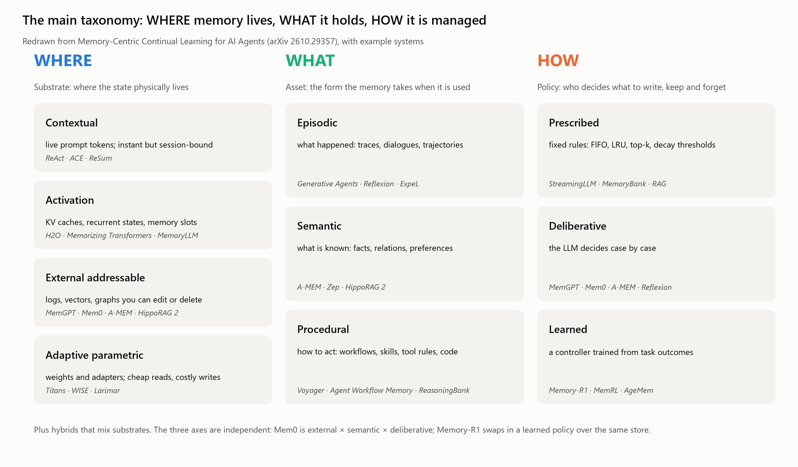
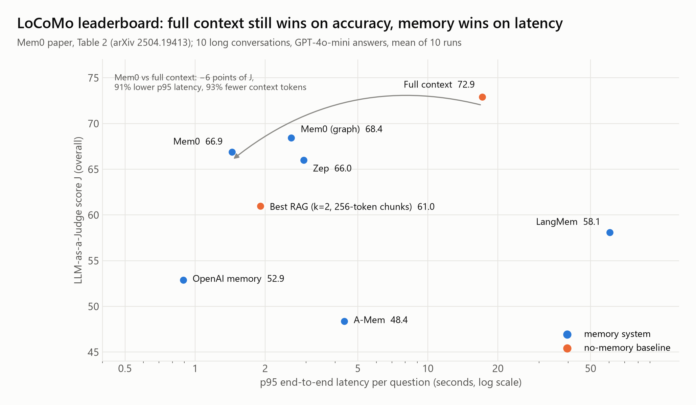

# Memory for LLM Agents: a late-2026 field guide

**CMPE 297 short story (individual assignment) · Pratham Gala · San José State University · November 2026**

An original article, slide deck and video presentation on **memory for LLM agents**. It synthesizes five survey papers published between April and November 2026, plus two independent benchmark papers that supply the leaderboard and ablation results.


## Deliverables

| Deliverable | Where |
|---|---|
| Medium article | [Your Agent Remembers Everything and Learns Nothing](https://medium.com/@prathampravin.gala/your-agent-remembers-everything-and-learns-nothing-9c673d303c1a) (source: [`article/medium_article.md`](article/medium_article.md)) |
| Slide deck on SlideShare | **SLIDESHARE_URL** (source: [`slides/memory_for_llm_agents.pptx`](slides/memory_for_llm_agents.pptx), [`slides/memory_for_llm_agents.pdf`](slides/memory_for_llm_agents.pdf)) |
| Video presentation (YouTube) | **YOUTUBE_URL** |
| Video file in this repo | [`video/memory_for_llm_agents_tts_draft.mp4`](video/memory_for_llm_agents_tts_draft.mp4): 16 min 38 s, 1080p, narrated with Windows text-to-speech |
| Narration script (timed, per slide) | [`video/narration_script.md`](video/narration_script.md) |
| Figures (20, all original) | [`figures/`](figures) (article versions) and [`figures/slides/`](figures/slides) (slide versions) |
| Numbers behind every chart, with sources | [`data/benchmark_numbers.json`](data/benchmark_numbers.json) |
| Reading list with links | [`papers/reading_list.md`](papers/reading_list.md) |

## Papers covered

| Role | Paper | Date |
|---|---|---|
| **Main survey** | Li et al., *Memory-Centric Continual Learning for AI Agents*, [arXiv 2610.29357](https://arxiv.org/abs/2610.29357). HIT Shenzhen, Tsinghua, Southeast University, Huawei, China Telecom | Oct 21, 2026 |
| Survey: governance | Ding et al., *Always-On Agents: A Survey of Persistent Memory, State, and Governance in LLM Agents*, [arXiv 2606.30306](https://arxiv.org/abs/2606.30306) | Jun 29, 2026 |
| Survey: model level | Zhoubian, Zhang, Kharlamov, Tang, *Memory for Large Language Models*, [arXiv 2607.25380](https://arxiv.org/abs/2607.25380). Tsinghua, NUS, Bosch AI | Jul 28, 2026 |
| Survey: evolution | Luo, Tian et al., *From Storage to Experience: A Survey on the Evolution of LLM Agent Memory Mechanisms*, [arXiv 2605.06716](https://arxiv.org/abs/2605.06716). ACL 2026 Findings | May 7, 2026 |
| Survey: security | Lin, Hao et al., *A Survey on Long-Term Memory Security in LLM Agents*, [arXiv 2604.16548](https://arxiv.org/abs/2604.16548). Expanded EMNLP 2026 paper | Apr 17, 2026 (v6 Nov 20, 2026) |
| Leaderboard: independent | Huang et al., *Harness the Memory: A Holistic Evaluation of Memory Substrates in Memory Agents*, [arXiv 2608.15008](https://arxiv.org/abs/2608.15008) | Aug 2026 (v2 Nov 4, 2026) |
| Leaderboard: tool-use agents | Mishra & Mishra, *When Does Memory Help? A Cost-Aware Evaluation of Long-Term Memory in Tool-Using LLM Agents (MERIT)*, [arXiv 2609.05441](https://arxiv.org/abs/2609.05441) | Jul 2026 |

The leaderboard also uses three widely cited reference papers: [Mem0](https://arxiv.org/abs/2504.19413) (LoCoMo results), [Zep](https://arxiv.org/abs/2501.13956) (LongMemEval results) and [LongMemEval](https://arxiv.org/abs/2410.10813).

## The short story in one page

**Main taxonomy (Memory-Centric Continual Learning).** Any memory system is a point on three independent axes:

- **WHERE** it lives: contextual, activation, external addressable, or adaptive parametric (plus hybrids)
- **WHAT** it holds: episodic, semantic or procedural assets
- **HOW** it is managed: prescribed rules, deliberative LLM decisions, or a learned controller

The lifecycle is two coupled loops. The inner memory-state loop forms, consolidates, retrieves, and revises or forgets memories. The outer policy loop uses task feedback to change how the inner loop is run. The paper's test: *a memory write counts as learning only if it is read later and changes behavior.*



**Supporting lenses.**

- *From Storage to Experience* orders the field as Storage → Reflection → Experience.
- *Memory for LLMs* sorts model-level mechanisms (KV caches, state-space models, Titans-style test-time memory) by representation, update dynamics and persistence.
- *Always-On Agents* and the security survey add a governance layer: provenance, scoping, rollback and verified forgetting.

**Techniques on the leaderboards.** MemGPT/Letta (OS-style paging), Mem0 (extract, then ADD/UPDATE/DELETE/NOOP), Zep/Graphiti (bi-temporal knowledge graph), and experience memories: Reflexion, ExpeL, Agent Workflow Memory, ReasoningBank, Voyager, and learned controllers such as Memory-R1.

**What the numbers say.**

| Finding | Evidence |
|---|---|
| On LoCoMo, full context still has the best accuracy; memory wins on cost | Full context 72.9 J vs Mem0 66.9 J, but 17.1 s vs 1.4 s p95 latency and 93% fewer tokens |
| On longer histories, structured memory beats brute force | LongMemEval_S with GPT-4o: Zep 71.2% vs full context 60.2%, about 90% lower latency |
| No substrate wins everywhere | Harness the Memory: a graph wins LoCoMo/LongMemEval, a gist index wins long-range tasks, conflict resolution is at most 0.32 for every substrate |
| More retrieval can hurt agents that act | Harness: larger top-k helps QA but lowers ALFWorld success; coding gains are small or negative |
| Changing facts break similarity search | MERIT hard tier: embedding retrieval 0.35–0.70 vs update-on-write 0.75–1.00; agents ignored the correct memory 45% of the time |
| Memory can make an agent worse over time | MCCL ablation: stateful − reset = +7.1 after 64 dialogues, −13.9 after 256 |
| The field under-studies forgetting and rollback | Always-On corpus: retrieval in 62% of 435 works, forgetting 15%, rollback 6% |



**My two cents** (argued in full in the article):

1. "Memory" is three problems: storage, learning and governance.
2. LoCoMo-style leaderboards are saturating and rank compression more than memory.
3. The write path is underrated.
4. Forgetting is a feature.
5. Match the substrate to the job and expect portfolios. Learning to route between memories is the next open problem.

## Repository layout

```
article/   medium_article.md (source), medium_article.html (local preview), medium_import.html (Medium-ready)
slides/    memory_for_llm_agents.pptx and .pdf (24 slides, narration in speaker notes)
video/     narration_script.md and the narrated MP4
figures/   20 article figures; figures/slides/ holds the slide versions (no embedded headline)
data/      benchmark_numbers.json: every plotted number with paper, table and metric
papers/    reading_list.md
src/       make_figures.py, render_article.py, build_deck.js, export_slides.ps1, build_video.py
```

## Rebuilding everything

Requirements: Python 3.10+ with `matplotlib numpy pillow markdown python-pptx imageio-ffmpeg`, Node 18+, and on Windows PowerPoint (for PDF/PNG export) plus the built-in text-to-speech voices.

```bash
python src/make_figures.py                          # article figures  -> figures/
FIG_MODE=slide python src/make_figures.py           # slide figures    -> figures/slides/
python src/render_article.py                        # article HTML     -> article/
cd src && npm install && cd ..                      # pptxgenjs
NODE_PATH=src/node_modules node src/build_deck.js   # deck + narration -> slides/, video/narration_script.md
powershell -ExecutionPolicy Bypass -File src/export_slides.ps1   # PDF + PNGs
python src/build_video.py                           # narrated MP4     -> video/
```

## Notes on sources and originality

- The article, slide text and narration are written from scratch. No text is copied from the papers or from existing articles. Every figure is my own drawing or chart, built from numbers and taxonomies reported in the papers.
- Several leaderboard numbers come from papers by the system's own authors (Mem0, Zep). The article says so, and also uses two independent evaluations.
- Paper metadata (dates, versions, venues) was checked against the arXiv abstract pages in November 2026.
