# Your Agent Remembers Everything and Learns Nothing

### A late-2026 field guide to memory for LLM agents: what five new surveys agree on, what the leaderboards actually measure, and where I think the field is heading

*By Pratham Gala · CMPE 297 short story · November 2026 · ~20 min read*

---

## The goldfish with a filing cabinet

Here is a frustrating experience most people have had with a chatbot or coding agent. You tell it on Monday that your staging database moved to a new host. On Wednesday it confidently connects to the old one. It still has the Monday conversation somewhere. It just doesn't *use* it.

The obvious fix in 2026 looks like "give it a bigger context window." Frontier models read hundreds of thousands of tokens, and some read millions. But a long window behaves like a desk, not a memory. LongMemEval, now the standard memory benchmark, showed this clearly. When GPT-4o got a user's whole chat history (about 115k tokens) instead of only the relevant sessions, its accuracy fell from 0.87 to 0.61. That is a 30% relative drop on questions whose answers were sitting in the prompt. Open models such as Llama 3.1 and Phi-3 dropped by 36–55%.

So "memory" for agents is its own engineering problem. You decide what to write down, how to organize it, when to bring it back, and when to throw it away. Over the last six months a wave of survey papers has tried to put structure on a field that grew very fast. I read five of them, plus two independent benchmark papers, so you don't have to. This article covers:

1. the taxonomies the surveys propose (and how they fit together),
2. the handful of techniques that keep showing up on leaderboards,
3. what the leaderboards and ablation studies really tell you, and
4. my own opinions on what is overhyped and what is underrated.

I keep the math light and spend the space on architectures, metrics and experiments.

---

## The reading list

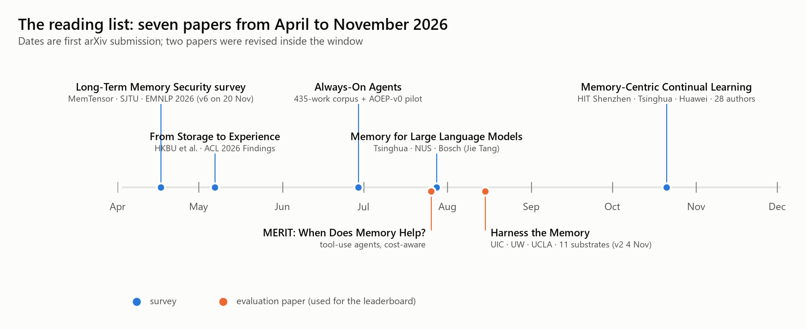

| # | Paper | Who | When | Why it's here |
|---|---|---|---|---|
| 1 | **Memory-Centric Continual Learning for AI Agents** (arXiv 2610.29357) | 28 authors from HIT Shenzhen, Tsinghua, Southeast University, Huawei and China Telecom's Xingchen AGI Lab | Oct 21, 2026 | **Main paper.** Gives the cleanest taxonomy (WHERE / WHAT / HOW), a lifecycle model, and an evaluation protocol, plus its own experiments |
| 2 | **Always-On Agents: A Survey of Persistent Memory, State, and Governance in LLM Agents** (arXiv 2606.30306) | Ding, Nannapaneni, Liu, Zhang | Jun 29, 2026 | Codes 435 papers by lifecycle stage and runs a governance "scorecard" pilot |
| 3 | **Memory for Large Language Models** (arXiv 2607.25380) | Tsinghua, NUS, Bosch AI (incl. Jie Tang) | Jul 28, 2026 | The model-level view: KV caches, state-space models, test-time memory |
| 4 | **From Storage to Experience: A Survey on the Evolution of LLM Agent Memory Mechanisms** (arXiv 2605.06716) | HKBU, HKUST, NUS and others | May 7, 2026 (ACL 2026 Findings) | A three-stage evolutionary view of agent memory |
| 5 | **A Survey on Long-Term Memory Security in LLM Agents** (arXiv 2604.16548) | MemTensor, SJTU, PKU, HKUST-GZ | Apr 17, 2026, revised to v6 on Nov 20, 2026 (expanded EMNLP 2026 paper) | Attacks and defenses across the memory lifecycle |
| 6 | **Harness the Memory: A Holistic Evaluation of Memory Substrates** (arXiv 2608.15008) | UIC, UW, McGill, MBZUAI, UCLA (incl. Philip S. Yu, Kai-Wei Chang) | Aug 2026, v2 Nov 4, 2026 | Independent head-to-head of 11 memory designs under one harness |
| 7 | **When Does Memory Help? A Cost-Aware Evaluation of Long-Term Memory in Tool-Using LLM Agents (MERIT)** (arXiv 2609.05441) | Mishra & Mishra | Jul 2026 | Measures whether memory changes what a *tool-using* agent does, and at what dollar cost |

Papers 1–3 were first posted in the June–October window. Papers 4 and 5 are a little older, but paper 5 was revised six times through November and paper 4 was accepted at ACL. For the leaderboard I also use three widely cited reference papers: **Mem0** (LoCoMo results), **Zep** (LongMemEval results) and **LongMemEval** itself.

---

## One picture to hold it all: three layers and a cross-cutting question

The surveys do not compete with each other. They describe different layers of the same stack. This is how I fit them together:

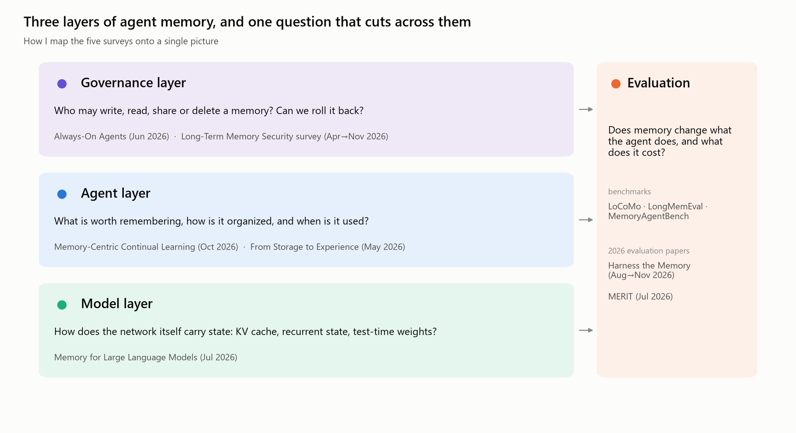

- **Model layer.** How does the network itself carry state? This covers KV caches, recurrent states in models like Mamba, and weights updated at test time. *Memory for Large Language Models* lives here.
- **Agent layer.** What should the agent write down, how should it be organized, and when should it come back? This is the main survey and *From Storage to Experience*.
- **Governance layer.** Who may write or read a memory, can it be deleted for real, and can a bad one be rolled back? This is *Always-On Agents* and the security survey.
- **Evaluation** cuts across all three. Does memory change what the agent *does*, and what does it cost?

The rest of the article walks through these layers in order.

---

## The main taxonomy: WHERE, WHAT and HOW

The main survey (Li et al., *Memory-Centric Continual Learning*) makes a deliberately provocative claim. **Memory should be judged by whether it improves future actions, not by what it can retrieve.** Under that lens, most of today's systems are passive caches that happen to be good at quiz questions.

To organize the space, the authors classify any memory system along three independent axes:

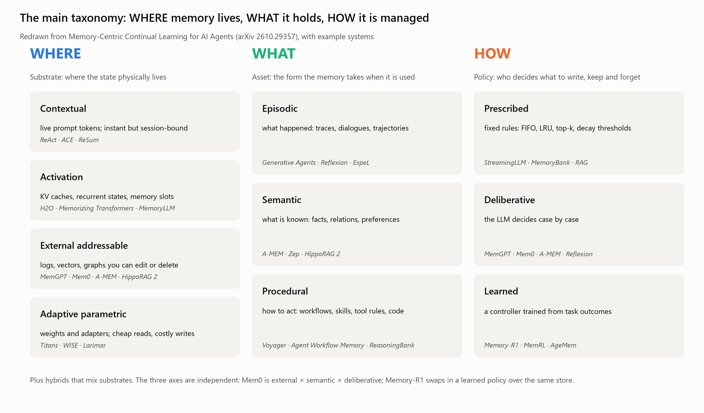

**WHERE: the substrate.** This is where the state physically lives.

- *Contextual* memory is tokens in the live prompt: scratchpads, rolling summaries, ACE-style evolving "playbooks." It takes effect instantly and dies with the session, and every summary loses something.
- *Activation* memory is KV caches, recurrent states and dedicated memory slots. It has high bandwidth, but it is tied to one model and is hard to inspect or move.
- *External addressable* memory is logs, vector indexes, graphs and trees (MemGPT, Mem0, A-MEM, HippoRAG 2). You can edit and delete it, which is a big deal. The failure mode the authors name is **functional forgetting**: a memory still exists but stops ranking high enough to be retrieved.
- *Adaptive parametric* memory is weights, adapters and fast weights (Titans, WISE, Larimar). Reads are free, but writes are expensive and hard to localize or undo.

**WHAT: the asset.** This is the form the memory takes *when it is used*.

- *Episodic*: what happened (traces, dialogues, trajectories). High fidelity, but expensive to keep.
- *Semantic*: what is known (facts, relations, preferences). Compact, but at risk of generalizing too early.
- *Procedural*: how to act (workflows, tool rules, code skills). Transfers directly into behavior, but quietly bakes in assumptions about the environment, such as a tool's version.

**HOW: the policy.** This is who decides what gets written, kept and forgotten.

- *Prescribed* policies use fixed rules: FIFO, LRU, top-k, decay thresholds. They are predictable and dumb.
- *Deliberative* policies let the LLM decide case by case. MemGPT, Mem0 and A-MEM all work this way. They are flexible and readable, but they are expensive and have no credit assignment: nobody tells the model whether last week's "save this" was a good call.
- *Learned* policies train a controller on task outcomes (Memory-R1, MemRL, AgeMem). This is the most promising and least mature option.

What I like about this framing is that the axes are **orthogonal**. Mem0 is external × semantic × deliberative. Swap in a learned policy over the same store and you get something like Memory-R1. Voyager is external × procedural (a library of code skills). You can place almost any system as a point in this 3-D space, and the empty regions point to research gaps. Learned policies over procedural memory are one example.

---

## The lifecycle: two loops, not one pipeline

Most system diagrams draw memory as a pipeline: write → store → retrieve. The main survey argues it is really **two coupled loops**:

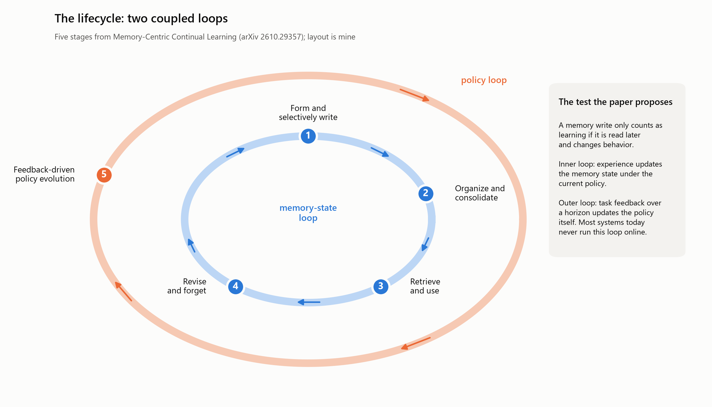

The **inner memory-state loop** has four stages:

1. **Formation and selective writing.** The paper calls admission the *plasticity boundary*: whatever passes it can change future behavior. Good systems tag each write with provenance, a time of validity, a scope and a confidence. Bad ones let "memory pollution" in.
2. **Organization and consolidation.** This turns episodes into reusable abstractions (ExpeL's insights, Voyager's skills). The risk has a name, **context collapse**: compression strips out *when*, *who* and *under what conditions*, and leaves a confident-sounding rule. One study cited in the survey found that repeated LLM rewriting of memories helps at first and then starts hurting.
3. **Retrieval and use.** A memory has to be preserved, found, *used*, and then change behavior. That four-step cascade comes back later as the key evaluation idea.
4. **Revision and forgetting.** The survey separates *invalidation* (the fact is no longer true, so mark it with an end date, as Zep/Graphiti does) from *capacity forgetting* (we ran out of room). It also separates both from *catastrophic* forgetting.

The **outer policy loop** is stage 5. Task feedback over a horizon updates the rules that run the inner loop. The authors describe three levels. At the state level, reflections are written into memory (Reflexion). With offline policy training, a controller is trained and then frozen. With online policy evolution, the rules keep improving in deployment, and the authors call this the least developed level.

The formal test behind this is simple and, I think, the most useful sentence in the paper. **A memory write counts as learning only if it is read later and produces a measurable change in behavior.** Storage alone doesn't count.

---

## A second lens: Storage → Reflection → Experience

*From Storage to Experience* (ACL 2026 Findings) arranges the same field along a history of increasing abstraction:

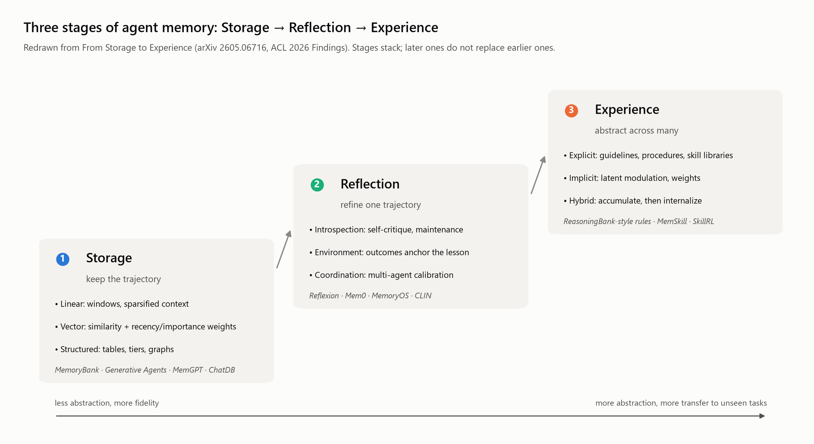

- **Storage** keeps the trajectory. It can be *linear* (context windows, compression), *vector* (similarity plus the recency and importance weights that Generative Agents popularized) or *structured* (tables, tiers, graphs).
- **Reflection** refines a single trajectory. It can be *introspective* (Reflexion's self-critique, Mem0's maintenance), *environment-anchored* (outcomes decide the lesson) or *coordinated* (several agents calibrate each other).
- **Experience** abstracts across many trajectories into rules, procedures and skills. These can be *explicit* (guidelines, skill libraries), *implicit* (pushed into latent states or weights) or a *hybrid* that accumulates first and internalizes later.

The paper's useful distinction is between *reflection* and *experience*. Reflection works inside one trajectory and produces a lesson tied to that task. Experience works across trajectories and produces something meant to transfer to tasks the agent has never seen. The authors also make an honest admission: they cannot rank stages quantitatively, because each stage optimizes a different objective. That is an early hint of the evaluation mess discussed below.

---

## Under the hood: memory inside the model

The Tsinghua/NUS/Bosch survey deliberately ignores agent frameworks and asks how the *architecture* holds state. It classifies mechanisms along three axes: representation (implicit or explicit), update dynamics (offline or online) and persistence (short or long term).

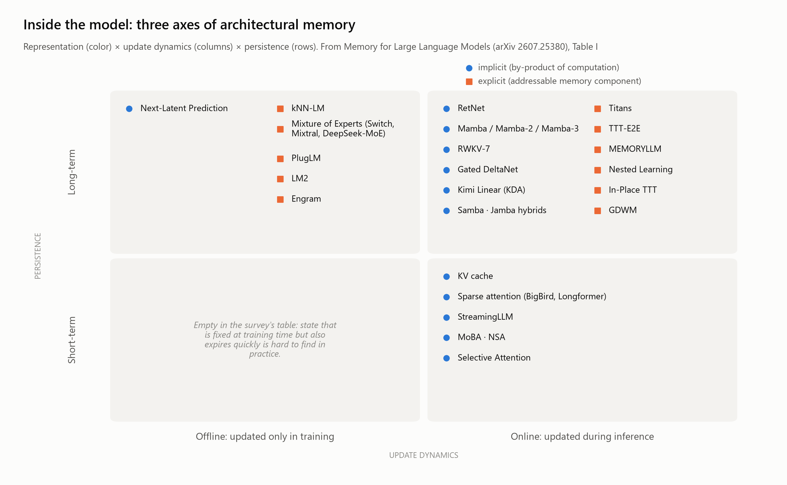

A few things jumped out at me:

- **Implicit memory** is a by-product of computation with no read/write interface of its own. It covers everything from the plain KV cache to the long list of linear-attention and state-space models (Mamba-3, RWKV-7, Gated DeltaNet, Kimi Linear). It is cheap and automatic, but capacity is bounded and you can't decide *what* it keeps.
- **Explicit memory** has an addressable component. Examples are kNN-LM's datastore, mixture-of-experts layers (which the authors treat as conditional parameter memory), plug-in key-value memories, and the **test-time learners**: Titans, TTT-E2E, MEMORYLLM and Nested Learning. These update a memory module *during inference*, often gated by how "surprising" the input is.
- The offline / short-term corner is empty. State that is fixed at training time but also expires quickly barely exists in practice. I found that oddly satisfying.

Their conclusion is that no single mechanism wins, so **hybrid architectures will become the norm**. That matches the agent-level surveys almost exactly. The same trade-off, *stability vs. plasticity*, shows up whether the memory is a recurrent state or a vector database.

---

## The techniques that keep showing up on leaderboards

Before the numbers, here are the three architectures that most leaderboard rows are built on:

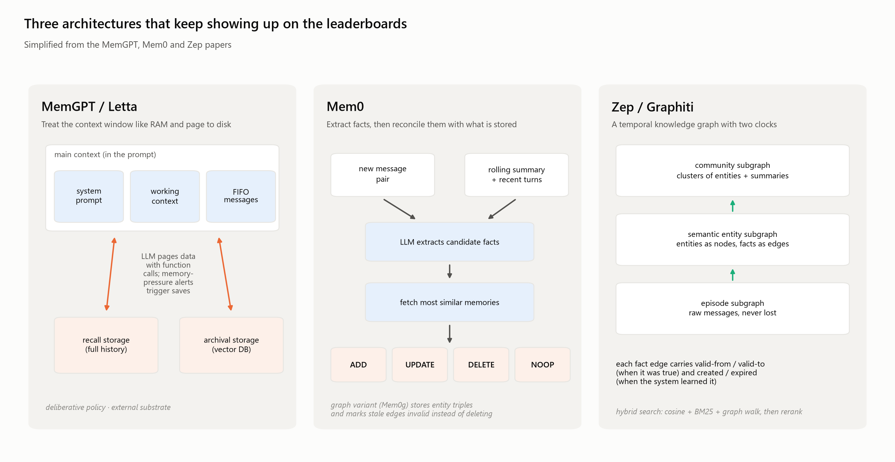

**MemGPT / Letta: the operating-system metaphor.** The context window is RAM. A *recall storage* holds the full message history and an *archival storage* is a vector database. The LLM moves data between them with function calls, and the system warns it when the context is getting full so it can save what matters. It was the first design that made "the agent manages its own memory" concrete. The cost is that every memory decision is an LLM call.

**Mem0: extract, then reconcile.** For each new message pair, an LLM extracts candidate facts using a rolling summary and the recent turns as context. Each candidate is compared with the most similar existing memories, and the LLM picks one of four operations: **ADD, UPDATE, DELETE or NOOP**. A graph variant (Mem0g) stores entity triples and marks contradicted edges as invalid instead of deleting them. The design is simple, and it targets the most common real-world need: *facts that change*.

**Zep / Graphiti: a knowledge graph with two clocks.** Memory has three tiers. An *episode* subgraph holds raw messages and never throws anything away. A *semantic* subgraph holds entities as nodes and facts as edges. A *community* subgraph holds clusters with summaries. Every fact edge is **bi-temporal**: it records when the fact was true in the world (valid-from / valid-to) and when the system learned or retired it. That lets an agent answer "where did Alice work *last year*?" without mixing up old and new facts.

Three families of **experience** techniques also come up in almost every survey:

- **Reflexion → ExpeL → Agent Workflow Memory → ReasoningBank.** This line goes from verbal post-mortems on single attempts, to insights extracted by comparing successes with failures, to reusable workflows (reported gains of +24.6% on Mind2Web and +51.1% on WebArena), to distilled reasoning strategies. They are procedural memory written in natural language.
- **Skill libraries (Voyager and its successors).** Executable code as memory. Voyager reported 3.3× more unique items discovered and tech-tree milestones reached up to 15.3× faster.
- **Learned controllers (Memory-R1, MEM1 and others).** These use reinforcement learning to decide *what* to store or how to compress a running state, instead of prompting an LLM to guess.

---

## The leaderboard, and how to read it

### LoCoMo: the benchmark everyone reports

LoCoMo has long multi-session conversations, each about 26k tokens, followed by questions about them. The best-known results table comes from the Mem0 paper:

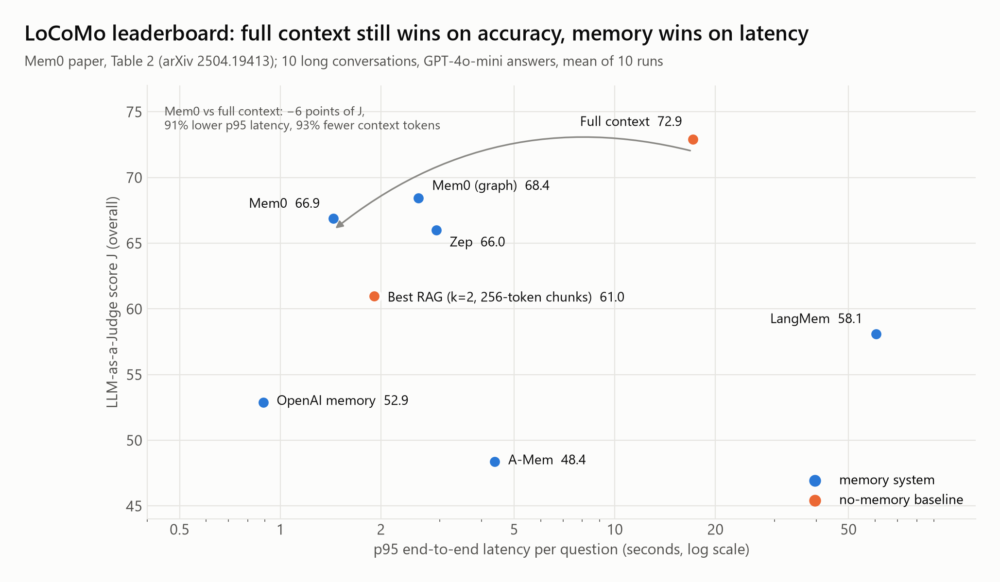

Two readings, both correct:

- **The headline:** Mem0 matches or beats every other memory system on accuracy while answering in 1.4 seconds at p95. Full context takes 17 seconds, and Mem0 uses 93% fewer context tokens.
- **The fine print:** *full context still scores highest* (72.9 vs. 66.9). A 26k-token conversation fits easily in a modern context window, so on LoCoMo memory is a **cost and latency** optimization, not an accuracy one. Also, the baselines in this table were run by Mem0's authors. Vendors publish conflicting numbers for the same systems, and the Harness paper found that LoCoMo and LongMemEval make up 62% of all reported benchmark-system pairs. The field is tuning hard to two datasets.

### LongMemEval: where memory beats brute force

LongMemEval is harder. It has 500 questions over histories of about 115k tokens (the *S* version) or 1.5M tokens (the *M* version), and tests five abilities: information extraction, multi-session reasoning, temporal reasoning, **knowledge updates** and **abstention** (knowing when *not* to answer). Here the picture flips:

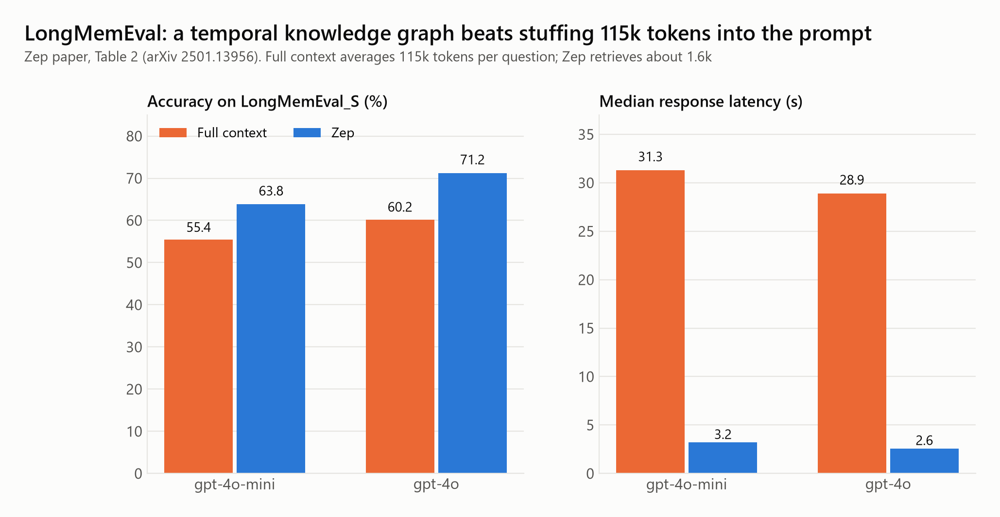

With GPT-4o, Zep's temporal graph scored **71.2% vs. 60.2%** for stuffing the whole history into the prompt. It cut latency by about 90% and read about 1.6k tokens instead of 115k. The gains were largest on temporal reasoning and preference questions. Zep was noticeably *worse* on questions about what the assistant itself said (94.6% → 80.4% with GPT-4o), which is a nice reminder that every compression drops something.

The LongMemEval paper also ran useful **design ablations**. Indexing each memory under extra keys made from extracted facts improved recall@k by 9.4% and accuracy by 5.4%. Expanding time-sensitive queries with explicit time ranges improved temporal recall by 7–11%. Storing memories per conversational round worked better than per whole session.

### Independent evaluation 1: Harness the Memory

Vendor tables compare full products. The *Harness the Memory* paper (Aug/Nov 2026) instead held **everything fixed except the memory substrate**: same backbone, same prompts, same harness. It then tested 11 designs on user-centric benchmarks (LoCoMo, LongMemEval-S, MemoryAgentBench) and agent-centric ones (ALFWorld for embodied tasks, BigCodeBench-Hard for coding).

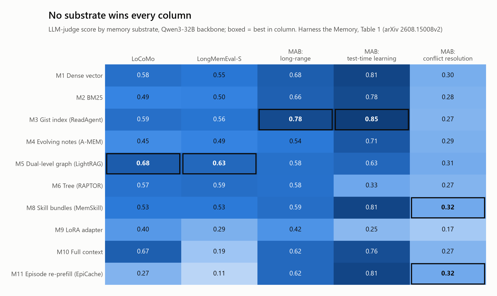

There is no single winner. A LightRAG-style dual-level graph tops LoCoMo and LongMemEval. A ReadAgent-style gist index tops long-range and test-time-learning tasks. Conflict resolution is bad for *everyone*: the best score is 0.32. Full context collapses on LongMemEval-S (0.19) because the history overflows the window. LoRA "memory in the weights" is the weakest design in almost every column.

Accuracy also has a cost:

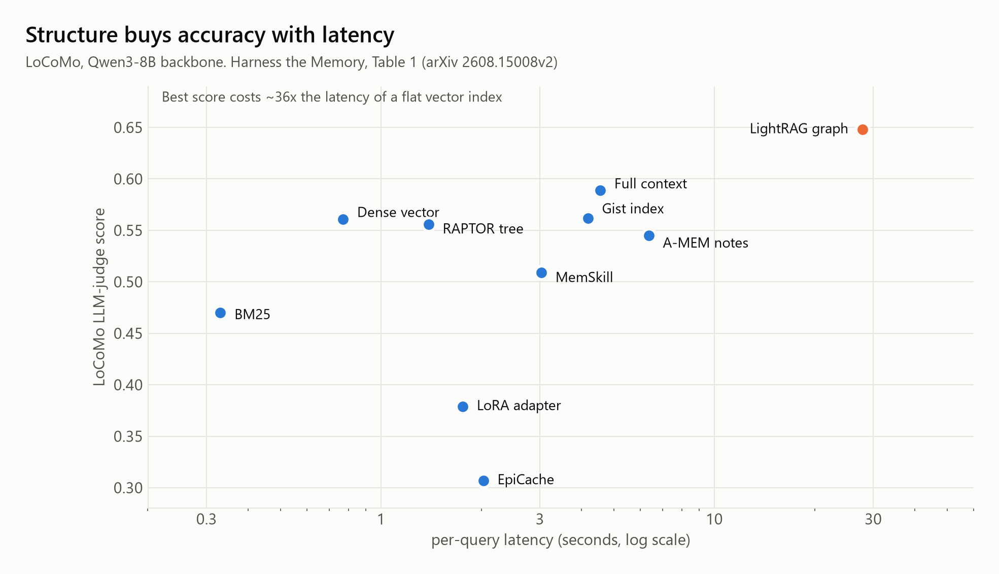

The graph that wins LoCoMo costs about 36× the per-query latency of a plain vector index. Its write path also consumed roughly 51M auxiliary-LLM tokens for one LoCoMo run, against zero for BM25.

The most interesting result, to me, is what happens when the agent has to *act*:

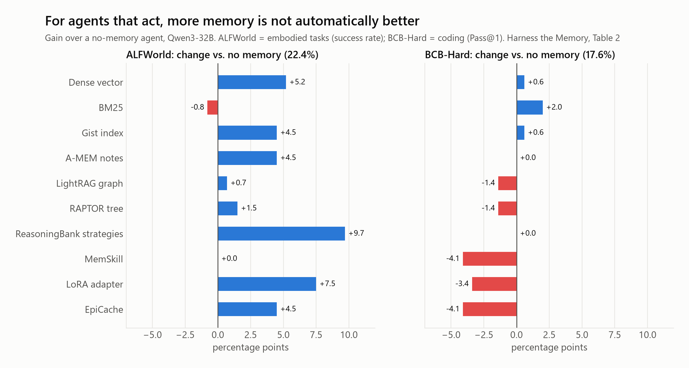

On embodied ALFWorld tasks, distilled strategies (ReasoningBank-style) gave the biggest boost, +9.7 points. On coding, almost everything *hurt* except simple lexical retrieval. The authors also ran a **retrieval-depth ablation**. On LoCoMo, retrieving more items (larger k) helped every substrate. On ALFWorld, it hurt. As k grew, the plain vector and BM25 indexes fell *below the no-memory baseline*. An attention probe suggested why: retrieved text pulls the model's attention away from the current observation and the list of valid actions. More memory is not automatically better for an agent that acts.

### Independent evaluation 2: MERIT, when facts change

MERIT asks the question I care about most as a builder. When a fact *changes* halfway through a series of tool-using tasks, does the agent act on the new value?

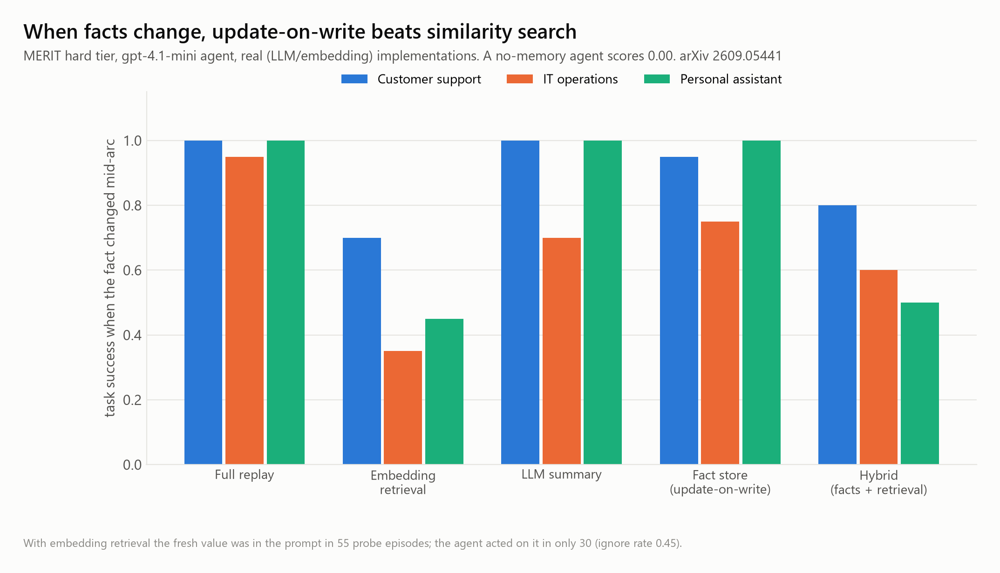

Without memory, the agent never succeeds (0.00). Full replay of past transcripts is immune to updates but expensive, and it struggles when several facts must be combined. **Embedding retrieval is the weak spot.** It returns the stale and the fresh value side by side with no recency signal, and success drops to 0.35–0.70. Update-on-write fact stores and LLM summaries stay at 0.70–1.00.

Two more MERIT findings stuck with me:

- **Agents ignore correct memories.** In 55 probe episodes the fresh value was in the prompt, and the agent used it in only 30.
- **Extraction quality is a hidden variable.** Swapping the fact extractor, from regex to LLM or the reverse, moved one domain by up to **60 points**.

MERIT also reports *cost-adjusted marginal utility*: success gained per dollar spent. On that measure, full replay is never the economical choice.

---

## Ablations from the main paper: memory can make an agent worse

The main survey ran small but clever experiments with Mem0 and a Qwen3-30B model. Two results deserve to be better known.

**1. How the agent reads memory matters as much as what is stored.**

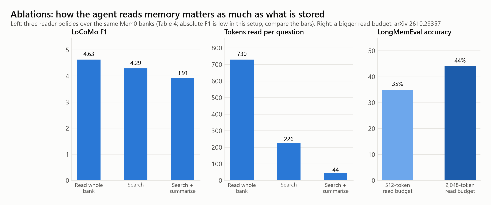

Over the *same* memory bank, reading the whole bank, searching it, and searching then summarizing gave F1 of 4.63, 4.29 and 3.91. Each step saves tokens (730 → 226 → 44) and costs accuracy. Separately, raising the read budget from 512 to 2,048 tokens took LongMemEval accuracy from 35% to 44%. (The absolute LoCoMo F1 is low in this setup. Compare the bars with each other, not with leaderboard numbers.)

**2. Memory that helps early can hurt later.**

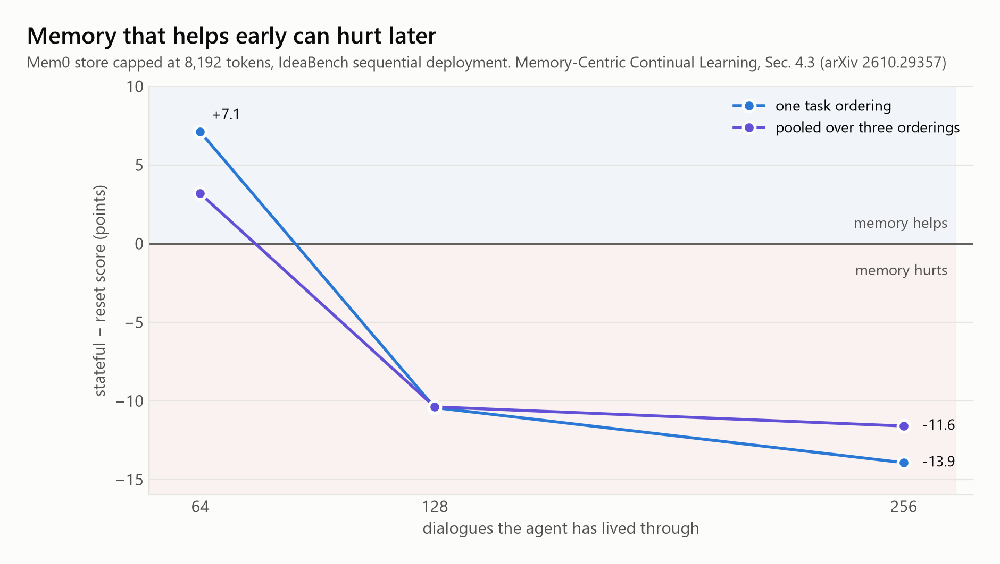

The authors compared an agent that keeps its memory (*stateful*) with the same agent reset to empty (*reset*) on a stream of research-ideation dialogues. After 64 dialogues, memory helped by +7.1 points. After 128 it *hurt* by about 10 points. After 256 it hurt by about 14. Periodic consolidation shrank the store from about 3,900 to about 1,800 tokens, but the gain stayed negative. Accumulated memory was crowding out useful context and pushing in stale assumptions.

I think this is the most important plot in the whole set of papers. Nearly every leaderboard measures a single point in time. This one measures a *trajectory*, and that is how agents are deployed.

---

## So how *should* we measure memory?

The main survey's answer is a **four-gate cascade**. I added evidence from the other papers to each gate:

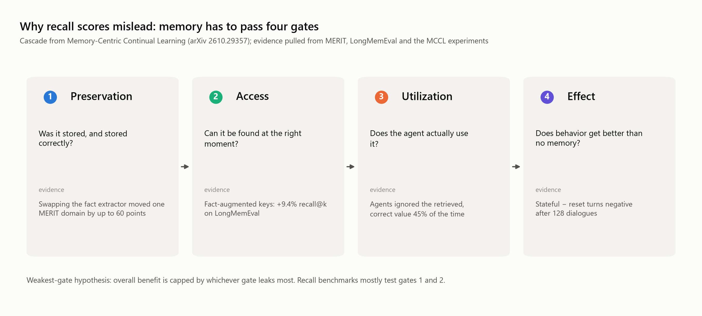

1. **Preservation.** Was it stored, and stored correctly? (MERIT's extractor swing.)
2. **Access.** Can it be found at the right moment? (LongMemEval's key expansion.)
3. **Utilization.** Does the agent actually use it? (MERIT's 45% ignore rate.)
4. **Effect.** Does behavior improve over no memory, now and later? (The stateful-minus-reset curve.)

The authors' "weakest-gate hypothesis" says the overall benefit is capped by whichever gate leaks most. Recall benchmarks mostly test gates 1 and 2. On top of the gates, the paper proposes three families of metrics:

- **Retention** under delay and interference: how much of a gain survives later.
- **Adaptation** to change: detection delay, steps to recover, how long stale errors persist.
- **Transfer**: zero-shot gains on new tasks, and a negative-transfer rate.

Every comparison runs against matched baselines (no memory, full history, static RAG and equal compute) so that "memory helped" can't secretly mean "we gave it more tokens."

If I could make one change to how papers report results, it would be this: **report stateful minus reset over time, plus cost per successful task.**

---

## The governance layer: remembering is easy, un-remembering is hard

*Always-On Agents* takes a different angle. It treats a long-running agent as a **persistent-state system**. Its state includes memories, but also task ledgers, permissions, credentials, commitments, audit logs and triggers. The authors coded 435 papers by which lifecycle stages they address:

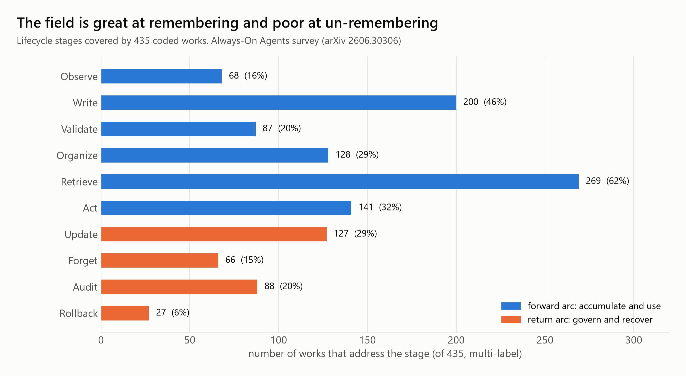

The imbalance is stark. 62% of works deal with *retrieval*. Only 15% deal with *forgetting* and only 6% with *rollback*. According to the authors, none of the coded works reports how successful or costly recovery actually is.

They describe the record each memory should carry along six axes: **authority, scope, mutability, provenance, recoverability and actionability**. They also propose five invariants a governed memory should never break: authority can't silently grow, scope can't silently expand, provenance is preserved, deletions propagate, and rollbacks are traceable.

Then they built a small evaluation contract, **AOEP-v0**, that scores *obligations* instead of answer quality. The test cases include a restart, a revoked permission, a deletion request and a poisoned tool output:

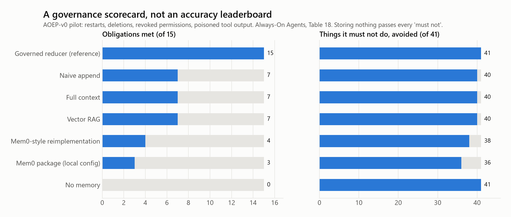

A governed reference design met 15 of 15 obligations. Raw-storage designs met 7. Systems that extract facts (a Mem0-style reimplementation and a local Mem0 configuration) met only 3–4. In two episodes they leaked a deleted billing address and an attacker-planted address. The authors say clearly that this is a small pilot, not a product verdict. The most important cell, though, is the **no-memory** row. It passes every "must not" check by storing nothing, and it fails every obligation. Safety and usefulness have to be measured *together*.

### Memory as an attack surface

The security survey (MemTensor and collaborators, EMNLP 2026) explains why this matters. Memory turns a one-shot prompt injection into a **persistent compromise**:

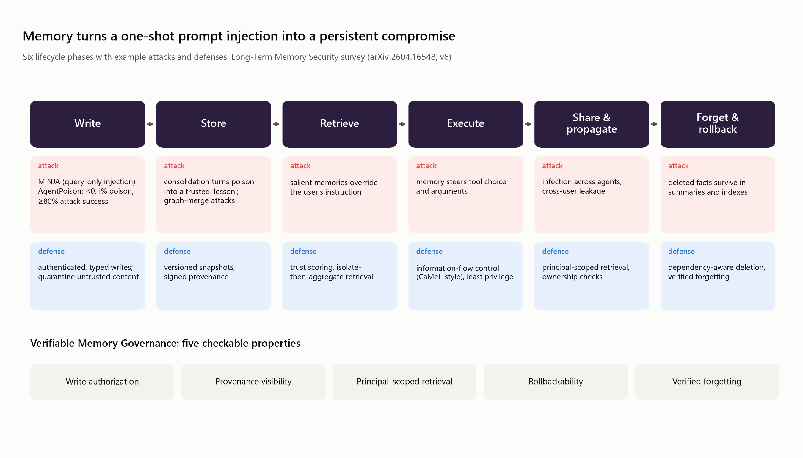

The attacks map onto six lifecycle phases. Two examples:

- At *write* time, MINJA plants poison using queries alone, and AgentPoison reported attack success of 80% or more with under 0.1% of the memory poisoned.
- At *store* time, consolidation can launder a poisoned entry into a trusted-looking "lesson."

*Retrieval* lets salient memories override the user's actual instruction. *Execution* lets memory steer which tools are called and with what arguments. *Sharing* spreads infection across agents and leaks data across users. At *forget* time, deleted facts survive in summaries and indexes.

The survey proposes **Verifiable Memory Governance**: five properties you can actually test. They are write authorization, provenance visibility, principal-scoped retrieval, rollbackability and verified forgetting. The last one is harder than it sounds. A single remembered fact leaves derivatives: raw logs, summary cards, vector indexes, reflected "lessons," shared stores. Deleting the original does not delete those. How coarsely you summarize decides how much a deletion request actually reaches.

---

## My two cents

After a few weeks with these papers, here is where I land.

**1. "Memory" is three problems sharing one word.** One is *storage engineering*: indexes, graphs, latency. One is *learning*: does experience improve future behavior? One is *governance*: who controls the state, and can it be undone? Most products and benchmarks solve the first, many papers claim the second, and almost nobody measures the third. Asking a vendor which of the three they mean clears up a lot of confusion.

**2. LoCoMo-style leaderboards are close to saturated, and the numbers mislead.** When the whole conversation fits in the context window and full context still wins, the leaderboard is really ranking *compression*. Add self-reported baselines, different judge models and missing cost columns, and I would not choose a memory system from a LoCoMo number. I would trust LongMemEval more, and the Harness- and MERIT-style controlled comparisons most.

**3. The write path is underrated.** MERIT's 60-point extractor swing, context collapse in consolidation, and poisoning that targets the write step all point the same way: most failures are set at *write* time. Yet retrieval gets most of the research attention (62% of works). If I were building an agent tomorrow, I would spend my effort on typed writes with provenance and validity times before I touched a reranker.

**4. Forgetting is a feature, not a bug.** The stateful-minus-reset curve going negative after 128 dialogues is the clearest evidence I've seen that unbounded memory degrades agents. We should treat agent memory the way we treat databases: schemas, migrations, tombstones, backups, and a garbage collector that is tested. Zep's choice to *invalidate* facts rather than overwrite them, and the security survey's verified forgetting, are steps in that direction.

**5. Match the substrate to the job, and expect portfolios.** From the controlled studies, my practical rule of thumb:

- facts that change → update-on-write store or a temporal graph
- "how to do things" → distilled strategies and skill libraries (the best ALFWorld gain)
- code reuse → simple lexical or vector retrieval
- short, self-contained tasks → no memory at all

The Harness paper found that a per-question oracle choosing among substrates would score 0.93 on LoCoMo versus 0.65 for the best single one (Qwen3-8B backbone). The learned router they tried did not transfer to unseen conversations. Learning to *route* between memories looks like the next big open problem.

**6. A prediction.** Within a year, memory APIs will ship provenance, versioning and per-user scoping by default, the way every serious database ships transactions. Regulation and enterprise buyers will force it, and the security survey's results make the case. The systems that win the next leaderboard will be the ones that can show you *why* they remembered something and prove they forgot it.

---

## A builder's checklist

- Always run **no-memory** and **full-context** baselines. Report **stateful minus reset** at several points in time.
- Tag every write with **source, timestamp, validity window, scope and confidence**.
- For mutable facts, use **update-on-write** or **bi-temporal** edges. Don't rely on similarity search alone.
- Show the model *recency and provenance* next to each memory. Agents ignore correct memories that look no different from stale ones.
- **Cap, consolidate and audit.** Keep raw episodes so consolidation can be checked and rolled back.
- **Scope retrieval by user**, and test deletion by probing summaries and indexes for leftovers.
- Track **tokens, latency and dollars per successful task**, not only accuracy.
- Keep retrieval **shallow for agents that act**. Top-k that helps QA can hurt planning.

---

## References

1. D. Li et al. *Memory-Centric Continual Learning for AI Agents.* arXiv:2610.29357, Oct 2026.
2. T. Ding, A. Nannapaneni, B. Liu, L. Zhang. *Always-On Agents: A Survey of Persistent Memory, State, and Governance in LLM Agents.* arXiv:2606.30306, Jun 2026.
3. S. Zhoubian, D. Zhang, E. Kharlamov, J. Tang. *Memory for Large Language Models.* arXiv:2607.25380, Jul 2026.
4. J. Luo, Y. Tian et al. *From Storage to Experience: A Survey on the Evolution of LLM Agent Memory Mechanisms.* arXiv:2605.06716, ACL 2026 Findings.
5. Z. Lin, X. Hao et al. *A Survey on Long-Term Memory Security in LLM Agents: Attacks, Defenses, and Governance Across the Memory Lifecycle.* arXiv:2604.16548 (v6, Nov 2026).
6. W.-C. Huang et al. *Harness the Memory: A Holistic Evaluation of Memory Substrates in Memory Agents.* arXiv:2608.15008 (v2, Nov 2026).
7. S. Mishra, S. Mishra. *When Does Memory Help? A Cost-Aware Evaluation of Long-Term Memory in Tool-Using LLM Agents.* arXiv:2609.05441, 2026.
8. P. Chhikara et al. *Mem0: Building Production-Ready AI Agents with Scalable Long-Term Memory.* arXiv:2504.19413, 2025.
9. P. Rasmussen et al. *Zep: A Temporal Knowledge Graph Architecture for Agent Memory.* arXiv:2501.13956, 2025.
10. D. Wu et al. *LongMemEval: Benchmarking Chat Assistants on Long-Term Interactive Memory.* arXiv:2410.10813, ICLR 2025.
11. C. Packer et al. *MemGPT: Towards LLMs as Operating Systems.* arXiv:2310.08560, 2023.

*All figures are my own, drawn from numbers and taxonomies reported in the papers above. The data behind every chart is in the companion GitHub repository.*
